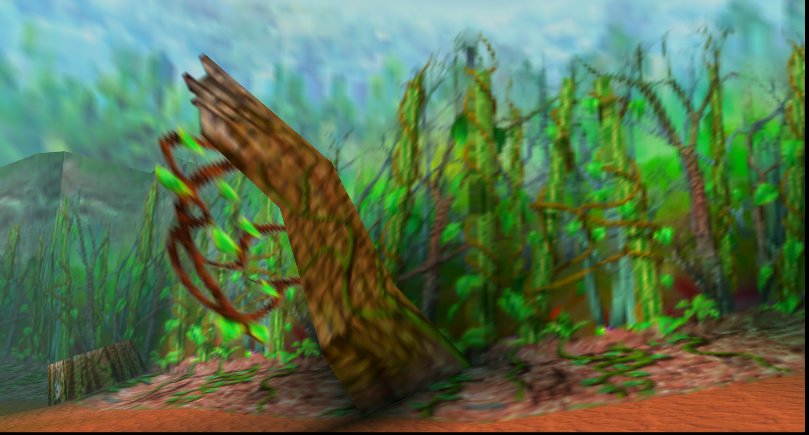
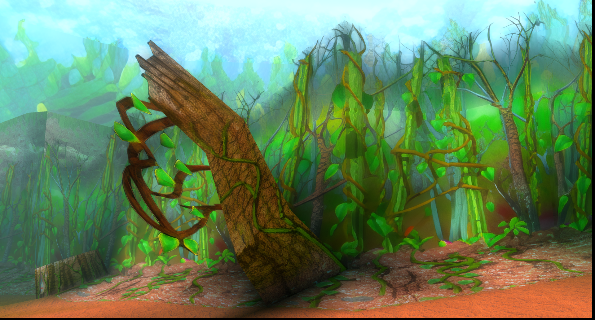
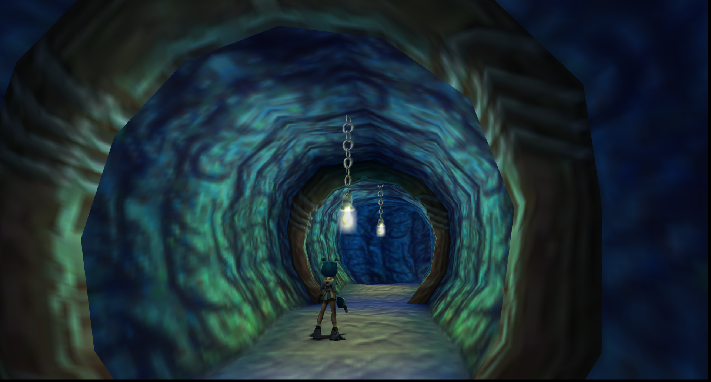
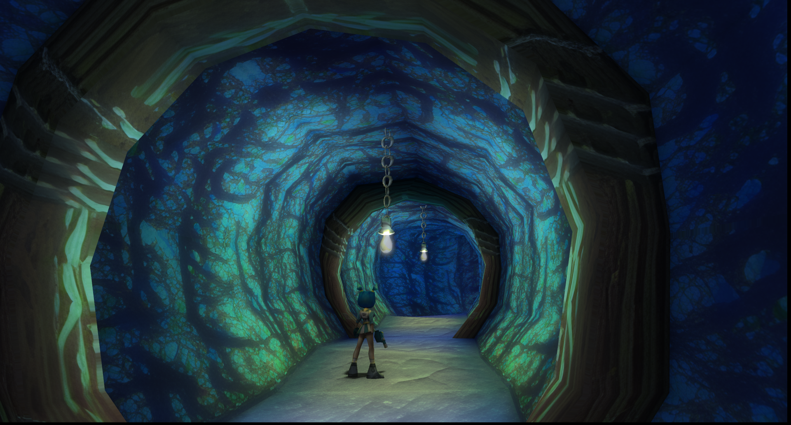
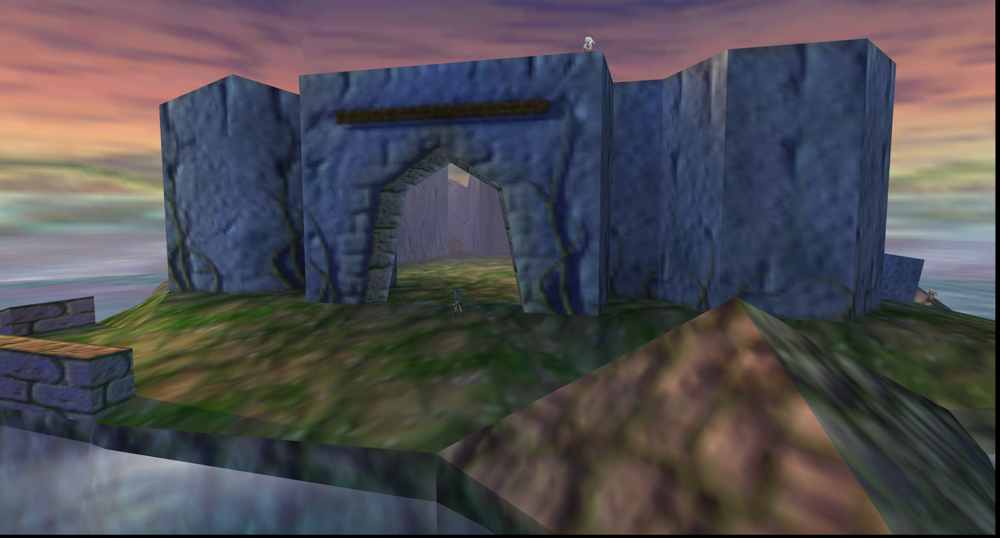
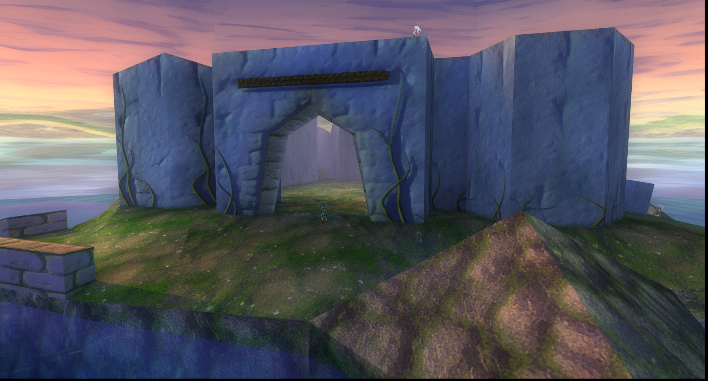

# Jet Force Gemini — HD Texture Pack


This is an HD texture pack project for [Jet Force Gemini Recomp](https://github.com/VibinToast/JetForceGemini-Recomp). This repository contains the .rtz files you can throw into the game for HD textures.

This pack has 1K, 2K, & 4K resolution. Download only one of these!

## Screenshots

<!-- Replace these placeholders with your own screenshots. -->
| Before | After |
|---|---|
|  |  |
|  |  |
|  |  |

## Download

Get the latest release from the repository’s **Releases** page.

**Current version:** `v1.0.0`  
**Status:** In development

## Installation

1. Make sure you have a legally obtained copy of the game.
2. Download recomp from here: [Latest Recomp Download](https://github.com/VibinToast/JetForceGemini-Recomp/releases/latest)
2. Download the texture pack from the latest release here.
3. Drag and drop the .rtz file into ```JetForceGemini-Recomp/texture_packs```
6. Launch the game and select the texture pack, or press F6 in game to cycle

## Known Issues

    - Fonts
    - Noticeable seams
    - Warped textures

> **Disclaimer:** This is a fan-made, non-commercial project. *Jet Force Gemini* and its related names and assets belong to their respective rights holders. This repository is not affiliated with or endorsed by them. Do not include original game files or other copyrighted assets unless you have permission to distribute them.
